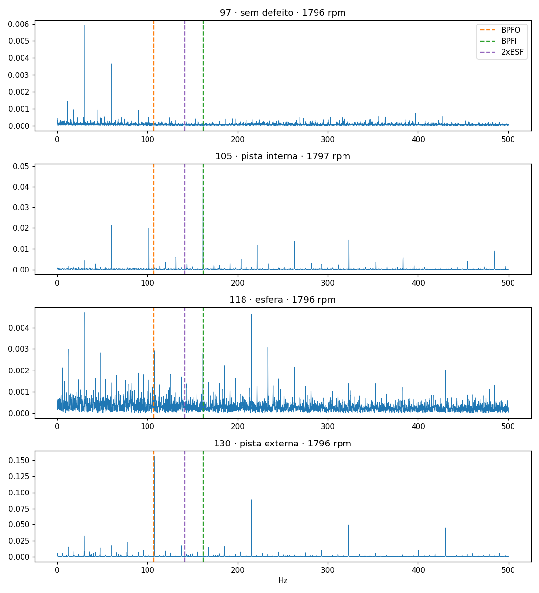

# cwru-envelope-lab

Reproduzindo, com dados públicos, a análise de envelope do benchmark de rolamentos da Case Western Reserve University (CWRU).

> **Estudo de referência:** W. A. Smith e R. B. Randall (2015), *Rolling element bearing diagnostics using the Case Western Reserve University data: A benchmark study*, Mechanical Systems and Signal Processing 64–65: 100–131. [doi:10.1016/j.ymssp.2015.04.021](https://doi.org/10.1016/j.ymssp.2015.04.021)

## A pergunta

Um defeito num rolamento gera impactos num ritmo que dá para calcular pela geometria. Se o sinal de vibração passar por uma análise de envelope, esse ritmo aparece como um pico na frequência certa? E quando não aparece, por quê?

## A bancada (de onde vêm os dados)

Fonte: [CWRU · Apparatus & Procedures](https://engineering.case.edu/bearingdatacenter/apparatus-and-procedures)

- Motor de 2 hp, transdutor de torque/encoder e dinamômetro.
- Rolamento SKF 6205-2RS no lado acionado, com defeitos de ponto único feitos por eletroerosão.
- Acelerômetro com base magnética na carcaça, posição 12 h.
- 12.000 amostras por segundo; cargas de 0 a 3 hp (1797 a 1720 rpm).

**Limite importante:** é um único motor, em bancada, com defeitos artificiais. Um modelo ajustado aqui não vale automaticamente para outro motor.

## Frequências teóricas de falha (1797 rpm)

| Falha | Multiplicador do eixo | Frequência |
|---|---|---|
| Pista externa (BPFO) | 3,5848 | 107,4 Hz |
| Pista interna (BPFI) | 5,4152 | 162,2 Hz |
| Esfera, "Rolling Element" (2×BSF) | 4,7135 | 141,2 Hz (BSF = 70,6 Hz) |

Multiplicadores oficiais da página [Bearing Information](https://engineering.case.edu/bearingdatacenter/bearing-information) da CWRU. O valor de "Rolling Element" que a CWRU publica é o dobro da frequência da esfera (2×BSF). O rolamento do lado do ventilador (6203) tem BPFO 3,0530, BPFI 4,9469 e 2×BSF 3,9874.

## Ensaios

| | Pergunta | Resultado |
|---|---|---|
| [Ensaio 1](notebooks/01_ensaio1_envelope.ipynb) | O envelope do sinal bruto (Método 1 do artigo) acha as três falhas? | **3 de 4.** Pista externa e interna em 1º lugar; sem defeito limpo; esfera escondida. |
| [Ensaio 2](notebooks/02_ensaio2_esfera.ipynb) | Os Métodos 2 (cepstro) e 3 (curtose espectral, simplificado) acham a esfera? | **2 de 9.** Cepstro acha a de 0,021"; envelope acha a de 0,007" pela BSF; a de 0,014" não aparece. |
| [Ensaio 3](notebooks/03_ensaio3_dominio.ipynb) | Um classificador treinado num rolamento funciona com outra carga ou outro rolamento? | Modelo em Hz fixos: **100% → 26% → 33%**, com até 83% de falsos negativos. Modelo com a frequência de falha de cada rolamento: **100%** nos três testes. |

**Critério de acerto:** o maior valor a ±2% da frequência teórica fica entre os 3 maiores picos do espectro de envelope (5–500 Hz).



## Como repetir

```bash
pip install -r requirements.txt
python data/download.py      # baixa 20 arquivos (~62 MB) do site da CWRU e confere o SHA-256
jupyter notebook notebooks/
```

Os dados ficam no site oficial da CWRU; o script baixa e confere cada arquivo, para ninguém depender de uma cópia.

## O que este repositório não faz (ainda)

- Não confere linha a linha a tabela do artigo (o PDF é pago).
- O Método 3 é simplificado: escolhe a faixa por curtose espectral, sem a separação discreto/aleatório do benchmark.
- O ensaio 3 troca o rolamento e o sensor, mas o motor e a bancada são os mesmos. O próximo passo é testar num motor de outra bancada.

## Licença

Código sob MIT. Dados: Case Western Reserve University Bearing Data Center.
